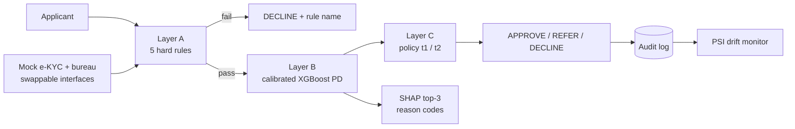
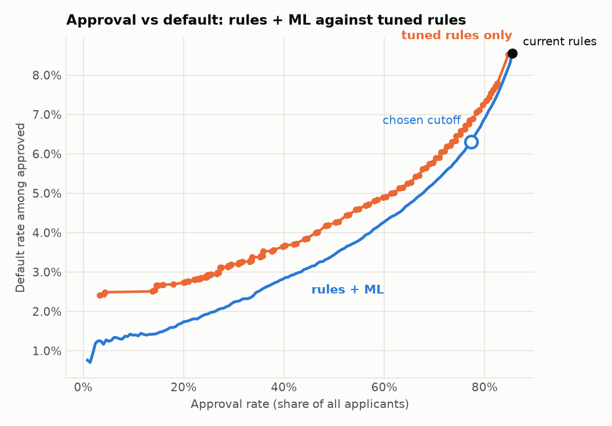
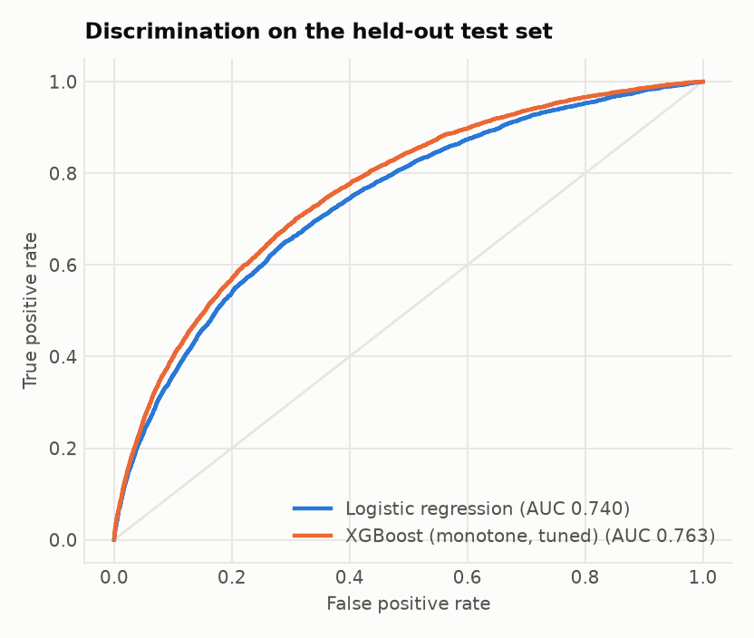
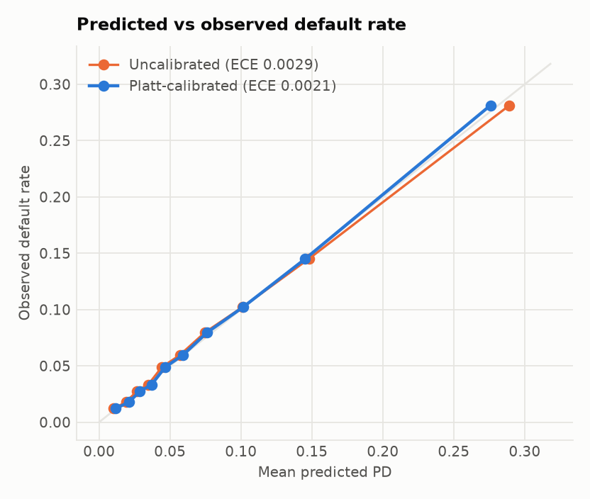
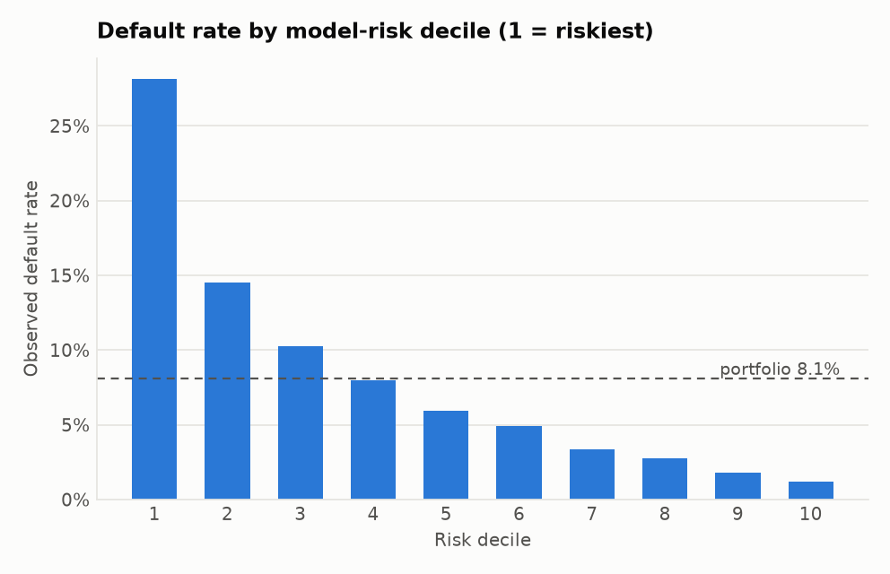

# Loan Decisioning Engine

A credit decisioning service that turns a loan application into a **decision, a risk score and plain-language reasons**: hard eligibility rules, a calibrated machine-learning default-risk model, a policy layer, an API a digital journey can call, a fairness audit and production monitoring. Built on the public Kaggle *Home Credit Default Risk* data.

**Live demo:** _add URL after deploy_ &nbsp;·&nbsp; **API docs:** `/docs` on the same host &nbsp;·&nbsp; **[Model card](reports/MODEL_CARD.md)** &nbsp;·&nbsp; **[Architecture](docs/ARCHITECTURE.md)** &nbsp;·&nbsp; **[Design decisions](docs/DECISIONS.md)** &nbsp;·&nbsp; **[Runbook](docs/RUNBOOK.md)**

> Every number on this page is generated by `python -m src.pipeline` into `reports/metrics.json` and injected here by `make results`. Nothing is typed by hand.

## What it does



- **Two layers, on purpose.** Policy and regulatory rules (age band, income floor, KYC, repayment burden, loan-to-income) are separate from the statistical score. A rule failure is always a DECLINE with a named rule; the model ranks risk among eligible applicants.
- **A model you can defend.** Monotone constraints (a better external score can never raise risk), Platt calibration (so PD behaves like a probability), a logistic-regression baseline on every run, SHAP reason codes that distinguish *missing* from *low*.
- **Measured honestly.** Cutoffs are chosen on validation; every figure is on an untouched test split with bootstrap 95% CIs. The comparison is against the best *tuned* rules-only policy (including a bureau-score floor), not a strawman, and the README says when a benchmark cannot reach the target.
- **Operable.** Request ids, an append-only audit log that can replay any decision, API-key auth, batch scoring, PSI drift monitoring, a model card generated from the metrics.

## Results

<!-- RESULTS:START -->
_307,511 applications, home_credit data, model `pd-xgb-20261017-1049-home_credit`. Held-out test split of 61,503. 95% bootstrap CIs in brackets._

| Policy (test set) | Approval rate | Default rate among approved |
|---|---|---|
| Current rules only | 85.6% (85.2-85.8%) | 8.6% (8.3-8.8%) |
| Tuned rules only, same 6.4% target default rate | 73.5% (73.0-73.9%) | 6.3% (6.1-6.5%) |
| Tuned rules only, same 77.3% approval rate as rules + ML | 77.7% (77.3-78.0%) | 6.9% (6.7-7.2%) |
| **Rules + calibrated XGBoost** | 77.3% (77.0-77.6%) | 6.3% (6.1-6.5%) |

At a matched approval rate (rules + ML 77.3%, best tuned rules-only 77.7%; matched within 0.25 pts on validation), the best rules-only policy (income floor, repayment cap, loan-to-income cap and a bureau-score floor, all tuned on validation) has a 6.9% default rate against 6.3% for rules + ML: **0.59 pts lower** (95% CI 0.47 to 0.7).

At the same ~6.4% default rate, rules + ML approves **3.84 pts more applicants** than the best rules-only policy (95% CI 3.63 to 4.05).

Versus the current rules, rules + ML lowers the default rate among approved by 2.26 pts at a 77.3% approval rate.

**Policy insight:** the 21-60 age rule removes the safest group. Applicants over 60 are 11.5% of applications and default at 4.8%, against 8.5% inside the band, so the rule pushes portfolio default up (overall 8.1%). Worth a business and legal review.

| Model quality (test) | |
|---|---|
| ROC-AUC | **0.763** (95% CI 0.756-0.769) |
| Gini / KS / PR-AUC | 0.526 / 0.3919 / 0.2469 |
| Logistic-regression baseline AUC | 0.74 |
| Calibration error (ECE) before / after Platt | 0.0029 / 0.0021 |

| Fairness audit (test) | Approval gap | Adverse-impact ratio | Gap under rules only |
|---|---|---|---|
| Gender (F / M) | 3.93 pts (95% CI 3.24 to 4.57) | 0.951 | 8.64 pts |
| Age band (21-30 / 31-45 / 46-60) | 3.73 pts (95% CI 2.79 to 4.52) | 0.957 | 8.5 pts |

Gender is not a feature; it can be predicted from the model inputs with AUC 0.7364 (0.5 = no signal). These are measured gaps, not a claim that the model is fair.

**Outcome funnel:** 1,670.2K previous applications. By client type, refusal rate ranges from 4.8% (New, n=301,363) to 21.2% (Repeater, n=1,231,261). By contract type, refusal rate ranges from 10.3% (Consumer loans, n=729,151) to 25.6% (Revolving loans, n=193,164). 2.5% of offers made (approved + unused) were never used.



| | | |
|---|---|---|
|  |  |  |

Full detail: [`reports/metrics.json`](reports/metrics.json), [`reports/MODEL_CARD.md`](reports/MODEL_CARD.md).
<!-- RESULTS:END -->

**How the policy comparison is built.** Rules can only *remove* applicants, so "rules + ML" can never approve more than the rules alone, and comparing against the current rules would be apples to oranges. The honest benchmark is the **best rules-only policy a lender could build**: the income floor, repayment cap and loan-to-income cap are grid-searched together with a **bureau / external-score floor** (the classic scorecard cutoff), all tuned on validation. Rules + ML is then compared with it two ways: at the same approval rate (how much lower is the default rate?) and at the same target default rate (how many more applicants can be approved?). If no rules configuration can reach the target, the table says so instead of hiding it. The REFER band is sized by manual-review capacity (5% of scored applicants by default, `--refer-share`), not by a statistical rule.

## Quickstart

```bash
make install                         # venv + dependencies
kaggle auth login                    # once; accept the competition rules on kaggle.com first
make data                            # downloads application_train.csv and previous_application.csv into data/ (git-ignored)
make pipeline                        # metrics.json, model card, figures, model.joblib
make results                         # inject the results block into this README
make notebooks                       # execute the four notebooks in place
make test lint                       # tests (97% coverage, gate at 90%) and ruff
make api                             # http://localhost:8000/docs
make ui                              # http://localhost:8501
```

No data yet? `make quick` runs the whole stack on synthetic data in seconds. Its output is stamped `resume_safe: false`, carries a banner in the model card and notebooks, and `make results` refuses to publish it.

### Call the API

```bash
curl -s localhost:8000/decision -H 'content-type: application/json' -d '{
  "pan_hash": "a3f9c1d2e4b5", "age_years": 34, "annual_income": 540000,
  "loan_amount": 450000, "annuity": 38000, "goods_price": 420000, "years_employed": 6.5 }'
```

Response fields: `decision`, `pd` (null when a hard rule declined first), `reasons` (SHAP, at most 3), `rule_results`, `failed_rules`, `thresholds`, `model_version`, `request_id`, `latency_ms`. Also `POST /decision/batch` (up to 100), `GET /model-info`, `GET /health`, `GET /stats`. Set `API_KEYS=k1,k2` to require `X-API-Key`.

### Monitor a running service

```bash
python -m src.monitor --log logs/decisions.jsonl   # PSI on score and key features; exit 1 on alert
```

## Engineering

| | |
|---|---|
| Tests | 98 tests: unit, property-based (Hypothesis), API, pipeline determinism, train/serve parity, a real-schema CSV run |
| CI | lint (ruff), tests with 90% coverage gate, synthetic pipeline + live API smoke test, Docker build |
| Reproducibility | fixed seeds, stratified split, versions and git SHA recorded in `metrics.json` |
| Data validation | schema, target, duplicates, ranges checked before training; a data-quality report is saved |
| Packaging | multi-stage Dockerfile, non-root user, healthcheck, `docker-compose.yml`, `render.yaml` |
| Swappable vendors | `BureauClient` / `KYCClient` protocols: replace the mock with a vendor client without touching the engine |

## Layout

| Path | Purpose |
|---|---|
| `src/features.py` | cleaning and features; one function for training and serving. Gender is not a feature |
| `src/rules.py` | Layer A: five pure rule functions, work on one applicant or a whole DataFrame |
| `src/model.py` | monotone XGBoost, Platt calibration, SHAP reason codes |
| `src/policy.py` | thresholds to decisions; cutoff picking; tuned rules-only benchmark |
| `src/engine.py`, `src/api.py` | orchestration and FastAPI service |
| `src/audit.py`, `src/monitor.py` | decision audit log; PSI drift report |
| `src/evaluation.py`, `src/fairness.py` | discrimination, calibration, lift, PSI, bootstrap; approval-gap audit and proxy test |
| `src/pipeline.py` | end-to-end offline run that writes everything in `reports/` |
| `notebooks/` | funnel, EDA and features, model and policy, explainability and fairness |
| `app/streamlit_app.py` | decision card with SHAP, policy explorer, funnel, model quality, fairness |
| `reports/` | `metrics.json`, `MODEL_CARD.md`, `funnel_summary.csv`, `figures/` |
| `docs/` | architecture, design decisions, runbook |

## Limitations (what this does not prove)

- **Selection bias.** Labels exist only for loans that were originally granted; there is no reject inference. Approval rates here are not what a live portfolio would see.
- **Outcome funnel, not a UX funnel.** `previous_application` shows how applications ended, not where users dropped inside a screen.
- **Mocks.** Bureau and e-KYC are deterministic fakes. The bureau score is mapped onto the `EXT_SOURCE_2` scale only as a stand-in when the caller supplies none; that mapping is unvalidated.
- **Illustrative rules.** The income floor and caps are example policy parameters in the dataset's own (unspecified) currency units, not a real lender's policy. The tuned-rules benchmark is only as strong as the levers searched (four thresholds and a score floor); a richer rules engine would narrow the gap.
- **No out-of-time validation.** The data has no application date, so stability over time is unknown.
- **Fairness is measured, not proven.** The audit reports approval gaps by gender and age band (with CIs) next to per-group default rates, and tests whether gender can be recovered from the model's inputs. It cannot see attributes that are not in the data. Age is a model input and a hard rule, so an age gap is expected. Next steps in practice: review features correlated with the attribute, test per-group thresholds only where legally permitted, monitor the gap over time.
- **Not production.** Missing: reject inference, automated retraining and champion-challenger, a real vendor behind the adapters, rate limiting, TLS and a retained, access-controlled audit store (see the [runbook](docs/RUNBOOK.md)).

## Data

Raw data is not committed (size, Kaggle licence). See [`data/README.md`](data/README.md).

## License

MIT
