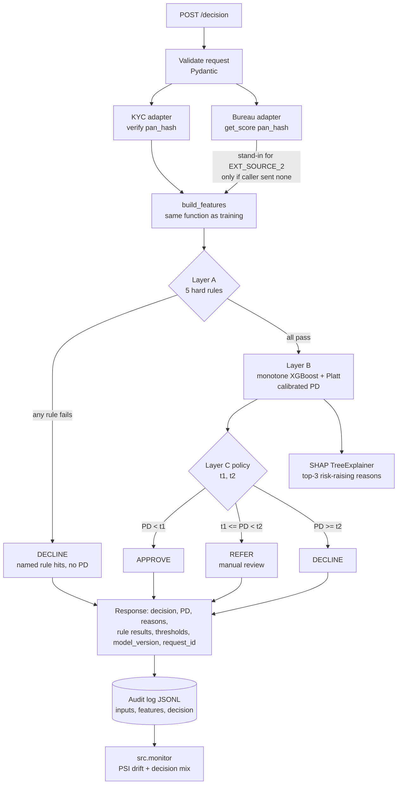
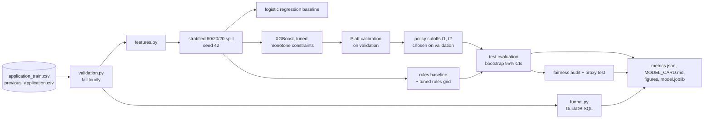

# Architecture

## Decision flow (one applicant)

## Offline pipeline (`python -m src.pipeline`)

## Modules

| Module | Responsibility | Depends on |
|---|---|---|
| `features.py` | cleaning + feature builder, the single source of truth for train and serve | pandas |
| `rules.py` | Layer A: five pure rule functions that work on a scalar applicant or a DataFrame | numpy |
| `model.py` | XGBoost, monotone constraints, Platt calibration, SHAP reason codes, save/load | features |
| `policy.py` | thresholds to decisions; cutoff picking; tuned rules-only benchmark | rules |
| `engine.py` | orchestrates adapters, features, rules, model and policy for one request | all of the above |
| `adapters.py` | `BureauClient` / `KYCClient` protocols and deterministic mocks | none |
| `api.py` | FastAPI: auth, request ids, batch, audit, stats | engine, audit |
| `audit.py`, `monitor.py` | append-only decision log; PSI drift report from that log | evaluation |
| `evaluation.py`, `fairness.py` | AUC/KS/Gini, calibration, deciles, PSI, bootstrap; approval-gap audit | sklearn |
| `pipeline.py`, `results_table.py`, `model_card.py` | offline run; README block and resume numbers; model card | everything |

The engine depends on adapter *interfaces*. Replacing a mock with a vendor client touches `adapters.py` only.

## Guarantees (and the test that enforces each)

| Guarantee | Test |
|---|---|
| Serving builds exactly the features training did | `test_engine.py::test_train_serve_parity_features_match_build_features` |
| A hard rule failure always wins, and skips the model | `test_api.py::test_decline_with_rule_hit_skips_model` |
| Higher external score never raises predicted risk | `test_model.py::test_monotone_constraint_holds_for_external_score` |
| Calibration never changes the ranking | `test_model.py::test_calibration_preserves_ranking_and_bounds` |
| Same seed gives the same metrics | `test_pipeline.py::test_pipeline_is_deterministic` |
| Synthetic numbers cannot reach the README | `test_pipeline.py::test_results_table_refuses_to_publish_synthetic_numbers` |
| Every logged decision can be replayed | `test_api_ops.py::test_audit_log_records_replayable_decision` |
| Drift monitor alarms on shift, not on noise | `test_monitor.py` |
| Gender is never a model input | `test_features.py`, `test_pipeline.py::test_gender_is_audited_but_never_a_feature` |
